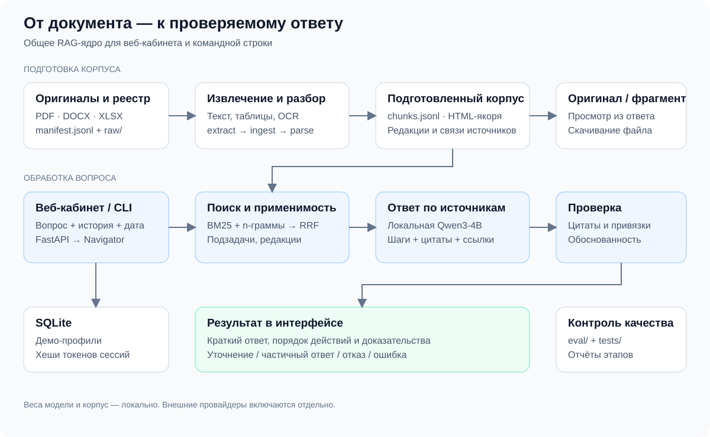

# Навигатор сотрудника по регламентам МФТИ

**Ekanam&Friends** · хакатон «ИИ в системе управления МФТИ» · задача 4.

## Веб-интерфейс

**[Открыть навигатор → ai-assist.ekanamfriends.ru](https://ai-assist.ekanamfriends.ru)**

Выберите демо-профиль сотрудника или преподавателя — пароль не нужен. Откройте «ИИ-ассистент» в сервисах или нажмите кнопку чата справа снизу.

Для проверки задайте: «Как открыть финансовый лицевой счёт?» Откройте доказательство, перейдите к точному фрагменту и скачайте оригинал документа.

## Доступ жюри к серверу

| Параметр | Значение |
|---|---|
| Сервер | `195.24.71.184` |
| SSH-порт | `22` |
| Пользователь | `mipt-review` |
| Вход | По SSH-ключу; парольный вход отключён |
| Каталог | `/project` — просмотр файлов релиза |

Перед первым входом передайте команде **публичный SSH-ключ** для добавления в учётную запись проверяющего. После подтверждения добавления ключа:

```sh
ssh -i /path/to/private_key -p 22 mipt-review@195.24.71.184
```

В терминале доступны команды просмотра: `help`, `ls`, `cd`, `cat`, `head`, `tail`, `grep`, `find`, `wc`, `sha256sum`, `pwd`, `exit`. Файлы доступны только для чтения; окружение ограничено проектом хакатона. [Устройство доступа](docs/PROJECT.md#серверное-развёртывание).

## Документация

**[Документация проекта: этапы, решения, папки и связи компонентов](docs/PROJECT.md)**

[План разработки E0–E6](ROADMAP.md) · [Запуск и настройка](docs/running.md) · [Требования и проверки](docs/requirements/coverage.md)

## Как работает

Сотрудник задаёт вопрос, система находит подходящие фрагменты регламентов и формирует краткий ответ с порядком действий, цитатами и ссылками на оригиналы. При недостатке сведений сообщает об этом или просит уточнение. Технические сбои показываются отдельно.



Документы PDF/DOCX/XLSX проходят извлечение текста и OCR, затем структурный разбор. Поиск объединяет BM25 и символьные n-граммы; локальная модель формирует ответ по найденным доказательствам, после чего проверяются цитаты и обоснованность. Веб и CLI используют общее Python-ядро. Данные корпуса хранятся в JSONL, профили и сессии — в SQLite.

Базовый локальный Docker-запуск без модели возвращает выдержки со статусом частичного ответа. Для генерации используется отдельный сервер модели; на CPU обработка может занимать несколько минут. [Подробности и ограничения](docs/PROJECT.md).
