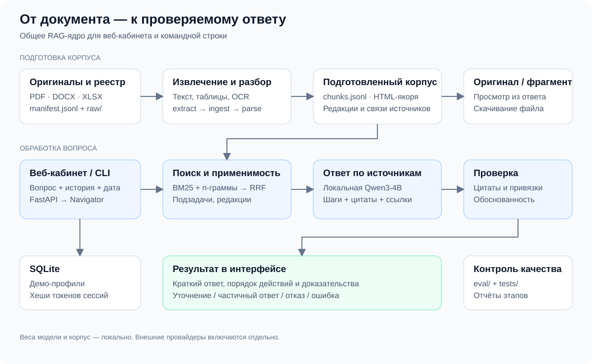

# Документация проекта

[README](../README.md) · [Запуск и настройка](running.md) · [План разработки](../ROADMAP.md)

Навигатор помогает сотруднику МФТИ получить ответ и порядок действий по внутренним регламентам. Это RAG-система: сначала она находит фрагменты документов, затем строит ответ с доказательствами. Здесь описаны устройство текущего кода, причины технических решений и развитие по этапам. Подробные протоколы проверок остаются в документах E0–E4; планы и незакрытые задачи — в ROADMAP.

## Как проходит вопрос



1. Пользователь выбирает демонстрационный профиль и открывает ИИ-ассистента в кабинете. Ассистент доступен отдельной страницей и через кнопку чата справа снизу; оба представления используют один диалог.
2. Браузер отправляет вопрос, историю и необязательную дату применимости в `POST /api/ask`. FastAPI проверяет сессию и входные ограничения, затем вызывает общее RAG-ядро. CLI обращается к тому же ядру через `make_navigator()`.
3. `Navigator` в `core/pipeline.py` организует обработку: учитывает историю, делит составной запрос, получает результаты поиска и сведения о применимости документов.
4. `HybridSearcher` в `core/search.py` совмещает BM25 по словам и символьным n-граммам. RRF объединяет ранги каналов. Расширения запросов помогают с сокращениями и перефразировками; реестр `revisions.json` добавляет сведения о редакциях и связях источников.
5. `LLMReasoner` получает отобранные источники, выбирает доказательства и строит структурированный ответ. Схемы, инструкции и представления утверждений находятся в `grounding.py`, клиенты моделей — в `llm.py`. Проверяются привязки цитат к фрагментам; отдельные вызовы модели оценивают обоснованность и полноту. Эти проверки снижают риск ошибок, но не заменяют экспертную сверку.
6. Веб-слой дополняет ответ ссылками на HTML-фрагмент и оригинал. Пользователь видит краткий ответ, шаги, цитаты, предупреждения и недостающие сведения. История хранится в памяти вкладки, а профили и сессии — в SQLite.

Ответ имеет один из статусов: `answer` — ответ, `partial` — частичный ответ, `clarify` — требуется уточнение, `not_found` — подтверждённых сведений в доступном снимке недостаточно, `error` — технический сбой. Ошибка модели не подменяется отказом по содержанию.

## Подготовка документов

Официальный корпус загружает `scripts/download_official.py`. Он работает с материалами организаторов; `regnav/sources/mipt.py` собирает отдельный вспомогательный корпус с сайта МФТИ. Эти источники нельзя смешивать при оценке покрытия кейса.

```text
manifest.jsonl + raw/
  → extract.py: PDF / DOCX / XLSX, OCR
  → extracted/: кэш извлечения с SHA-256 и версией обработчика
  → ocr-corrections.json: проверенные исправления конкретного снимка
  → text/: извлечённый текст
  → parse.py: структурные фрагменты и адреса
  → chunks.jsonl + view/ + import-report.json
  → поисковый индекс в памяти веб-процесса или CLI
```

`ingest.py` связывает этапы импорта. PDF сохраняет страницы, DOCX — адреса абзацев и ячеек, XLSX — листы, диапазоны, формулы и сохранённые значения. Для сканов используется Tesseract с русским языком. Отсутствующие результаты формул не вычисляются и не выдумываются. Исправления OCR привязаны к хешу исходника и ожидаемому тексту.

Манифест описывает происхождение файла и снимок загрузки; дата загрузки не равна дате действия нормы. На снимке от **11.11.2026** импорт E1 включал 20 файлов: 9 PDF, 8 DOCX и 3 XLSX, 1702 фрагмента. Это характеристика проверенного снимка, а не утверждение о текущем полном составе документов МФТИ. После обновления источников нужен повторный импорт и перезапуск процесса для пересоздания индекса.

## Технические решения и их причины

| Решение | Для чего принято | Где реализовано / ограничения |
|---|---|---|
| RAG с адресуемыми фрагментами | Дать проверяемый ответ по конкретным документам | `ingest.py`, `parse.py`, `pipeline.py`; ссылка ведёт к фрагменту и оригиналу |
| PDF, DOCX и XLSX в одном контуре | Сохранить регламенты, бланки и табличные приложения | `extract.py`; OCR и отсутствующие значения формул отражаются в отчёте |
| JSONL на диске, индекс в памяти | Упростить воспроизведение небольшого корпуса без отдельного сервера БД | `chunks.jsonl`, `search.py`; PostgreSQL и векторная БД пока не нужны для запуска |
| BM25 + символьный канал + RRF | Совместить точные термины и номера приказов с устойчивостью к вариантам написания | `search.py`; интерфейс эмбеддингов есть, штатный поиск не требует embedding API |
| Декомпозиция составного вопроса | Найти источники для каждой части и не потерять вторую процедуру | `pipeline.py`, `search.py`; эталоны в `eval/` |
| Явный реестр редакций | Не выбирать действующий приказ только по дате загрузки | `revisions.py`, `data/official/revisions.json`; неизвестная применимость остаётся неизвестной |
| Структурированный ответ и аудит доказательств | Не показывать действие, срок или согласующего без опоры на источник | `grounding.py`, `pipeline.py`, `verify.py`; качество проверяется также по сохранённым ответам и оригиналам |
| Отдельный режим `extractive` | Проверять поиск и интерфейс без модели | Возвращает выдержки с частичным статусом; не является полной генерацией и не включается молча при сбое LLM |
| Локальная Qwen3-4B через llama.cpp | Работать с моделью в серверном контуре и ограничить расход памяти | `scripts/start_local_model.ps1`, `compose.production.yaml`; CPU-ответ может занимать минуты |
| Адаптеры OpenAI-совместимого API и GigaChat | Менять провайдера без переписывания RAG-ядра | `llm.py`; наличие адаптера не означает проверенную живую интеграцию каждого провайдера |
| Локальный режим по умолчанию | Ограничить отправку документов внешним провайдерам | `privacy.py`; разрешены loopback и явно доверенные узлы, внешние API требуют отдельной настройки |
| FastAPI и локальные HTML/CSS/JS | Дать веб-кабинет без отдельной сборки фронтенда и внешних CDN | `regnav/web/`; оболочка основана на MGIMO-LMS, неподключённые разделы явно недоступны |
| SQLite для профилей и сессий | Обеспечить простой демо-вход и отзыв сессии при выходе | `accounts.py`; хранится хеш токена, демонстрационные профили выбираются без пароля |
| Один рабочий поток ответа | Ограничить нагрузку на локальную модель | `app.py`; занятый слот возвращает 429, таймаут не убивает Python-поток |
| Docker и отдельный том состояния | Повторять окружение и отделить корпус от изменяемых сессий | `Dockerfile`, `compose*.yaml`; корпус монтируется для чтения |
| Изолированный просмотр проекта по SSH | Дать жюри возможность читать файлы без доступа к остальным проектам сервера | `deploy/install_review.sh`, `review_shell.py`; вход по ключу, ограниченный набор команд |
| Эталоны, хеши и сохранённые отчёты | Сопоставить заявления о качестве с конкретными данными и кодом | `eval/`, `scripts/verify_*.py`, `data/official/`; replay не равен новой генерации |

Исследование альтернатив и заимствованные идеи: [prior-art.md](research/prior-art.md).

## Карта каталогов

| Папка | Что лежит и как связано с остальной системой |
|---|---|
| `regnav/` | Python-пакет приложения. `__main__.py` даёт CLI и собирает навигатор, используемый также вебом |
| `regnav/core/` | Независимое от кабинета ядро: импорт, разбор, поиск, генерация, проверка, редакции и ограничения провайдеров |
| `regnav/web/` | FastAPI в `app.py`, профили/сессии в `accounts.py`; вызывает ядро и выдаёт источники |
| `regnav/web/static/` | `index.html`, логика кабинета и чата `app.js`, стили `cabinet.css` и `style.css` |
| `regnav/sources/` | Сборщик открытых документов mipt.ru для вспомогательного корпуса |
| `data/` | Корпуса и результаты обработки. Корневые `raw/`, `text/`, `manifest.jsonl` относятся к вспомогательным данным |
| `data/official/` | Официальный корпус: манифест, фрагменты, связи, редакции, исправления OCR и отчёты E1–E5 |
| `data/official/raw/` | Оригиналы PDF/DOCX/XLSX; используются импортом и скачиванием через веб |
| `data/official/extracted/` | Кэш извлечения по документам, хешам и версии обработчика |
| `data/official/text/` | Текст для просмотра и диагностики импорта |
| `data/official/view/` | HTML-представления с якорями; на них ссылаются доказательства ответа |
| `data/official/evidence/` | Сохранённые данные проверок; не следует путать с текстом рабочего корпуса |
| `data/official/web/` | Локальная SQLite-база профилей и сессий при запуске с настройками по умолчанию; в Docker используется отдельное состояние |
| `data/official/e3-unit-runs/` | Артефакты отдельных прогонов тестов E3 |
| `data/official/e4-browser/`, `e4-checks/`, `cabinet-checks/`, `e5-checks/` | Отчёты, скриншоты и логи соответствующих проверок; это доказательства конкретных прогонов |
| `eval/` | Вопросы с ожидаемыми источниками, исправления эталонов и сверки сохранённых ответов. Используется скриптами оценки |
| `scripts/` | Загрузка корпуса, установка/старт модели, проверки этапов, сборка релиза и подготовка сервера; группы описаны ниже |
| `tests/` | Тесты ядра, импорта, этапов E2–E4 и HTTP-интерфейса; не заменяют проверку новых ответов модели |
| `deploy/` | Изолированный терминал проверяющего и его установка; серверные вспомогательные скрипты |
| `docs/` | Этот обзор, инструкции запуска, протоколы этапов и отдельные проектные заметки |
| `docs/requirements/` | Исходное описание кейса DOCX/текст и матрица требований с доказательствами |
| `docs/research/` | Исследование существующих решений и принятых подходов |
| `docs/assets/` | Схема архитектуры для README и документации |
| `models/` | Локальные веса модели; скачиваются отдельно и не включаются в Git |
| `.tools/`, `.tessdata/` | Локальные инструменты модели/OCR и языковые данные Tesseract |
| `.build/` | Локальная сборка: релизные архивы и служебные материалы; исключена из Git |
| `.venv/`, `.pytest_cache/`, `__pycache__/` | Окружение Python и автоматически создаваемые кэши; не исходный код проекта |
| `.git/` | История и служебные данные Git |

Каталоги с оригиналами, кэшами, весами и сессиями создаются локально и частично исключены из Git. В чистом клоне их отсутствие ожидаемо: корпус нужно получить и импортировать по [инструкции](running.md).

### Основные модули ядра

| Файл в `regnav/core/` | Ответственность |
|---|---|
| `extract.py` | Извлечение блоков из файлов, таблиц и OCR |
| `parse.py` | Модель фрагмента `Chunk`, деление по структуре, адресация |
| `ingest.py` | Манифест, кэш извлечения, исправления OCR, фрагменты, HTML и отчёт импорта |
| `text.py` | Нормализация и токенизация текста для поиска |
| `search.py` | Поисковые индексы, расширения/разбиение запросов, объединение рангов |
| `revisions.py` | Загрузка реестра и оценка применимости источников |
| `llm.py` | Клиенты моделей и выбор провайдера по окружению |
| `privacy.py` | Проверка допустимого провайдера и адреса локальной модели |
| `grounding.py` | Схемы JSON, инструкции модели, утверждения, доказательства и валидация |
| `verify.py` | Проверка присутствия цитаты в тексте |
| `pipeline.py` | `Navigator`, режимы ответа, поиск доказательств, генерация и аудит |

### Группы скриптов

- `download_official.py` — загрузка официального корпуса; `build_e2_fixtures.py` — подготовка контрольных материалов поиска.
- `setup_local_model.ps1`, `setup_e3_model.ps1`, `start_local_model.ps1`, `smoke_local_model.py` — установка, запуск и пробный вызов локальной модели.
- `verify_e1.py`, `verify_e2.py` — проверки импорта и поиска.
- `verify_e3.py`, `verify_e3_adversarial.py`, `verify_e3_evidence.py`, `apply_e3_reviews.py` — ответы, негативные сценарии, цитаты/якоря и привязка сверок к сохранённым результатам.
- `run_e3_tests.py`, `show_e3_progress.py`, `document_e3_tests.py` — прогон, наблюдение и документирование тестов E3.
- `verify_e4_live.py`, `verify_e4_browser.py`, `verify_e4_container.py`, `verify_cabinet_browser.py` — HTTP, браузер, контейнер и поведение кабинета.
- `verify_e5.py` — регрессия релизного снимка; сохранённые ответы воспроизводятся отдельно от новых обращений к модели.
- `build_release.py`, `prepare_server.sh` — сборка архива по разрешённому списку и подготовка серверного релиза. `prepare_server.sh` содержит хеш конкретного архива; после пересборки его нельзя применять без сверки хеша.

### Конфигурация в корне

`requirements.txt` задаёт зависимости ядра, `requirements-web.txt` добавляет FastAPI/uvicorn, `constraints-web.txt` закрепляет версии для веб-сборки. `pytest.ini` настраивает тесты. `.env.example` показывает переменные, а `.gitignore`/`.dockerignore` исключают локальные данные из Git/образа. CLI и uvicorn не читают `.env` автоматически; Compose читает.

`compose.yaml` запускает веб в режиме выдержек без LLM. `compose.local-model.yaml` подключает модель на хосте Docker. `compose.production.yaml` задаёт отдельные контейнеры веба и локальной модели. Команды установки, импорта, старта, остановки и таблица переменных — в [running.md](running.md).

## Развитие по этапам

Этапы описывают последовательное наращивание возможностей. Приведённые результаты относятся к датам и снимкам в протоколах; эта редакция документации не является повторным прогоном проверок.

| Этап | Что появилось и зачем | Документ / результат |
|---|---|---|
| E0 — условия и исходные данные | Требования, официальный корпус, ограничения передачи данных, вариант локальной модели и условия сдачи | [E0](E0.md), [матрица требований](requirements/coverage.md) |
| E1 — импорт | PDF/DOCX/XLSX и OCR, адресация, оригиналы, HTML, хеши и отчёт ошибок; без этого ответ нельзя проверить | [E1](E1.md): 20 файлов и 1702 фрагмента на снимке 11 ноября |
| E2 — поиск | Гибридный поиск, несколько подзадач, применимость и связи документов | [E2](E2.md): 26/26 контрольных запросов по обязательным фрагментам; это оценка поиска, а не качества генерации |
| E3 — проверяемый ответ | Краткий ответ, шаги, доказательства, уточнения, частичные ответы, конфликты и обработка сбоев | [E3](E3.md), [журнал тестов](E3-test-log.md): техническая сверка сохранённых ответов с источниками и проверки модели |
| E4 — веб и воспроизводимость | FastAPI, кабинет, источники, сессии, Docker и локальный режим | [E4](E4.md): проверки версии 13 ноября; изменения кабинета 14 ноября и их проверки — [отдельно](cabinets-backlog.md) |
| E5 — приёмка и сдача | Регрессия, новые вопросы, проверка развёртывания, комплект материалов и фактическая отправка | [ROADMAP](../ROADMAP.md), `data/official/e5-checks/`; наличие отчёта не подтверждает завершение сдачи |
| E6 — демонстрация и внедрение | Сценарий защиты, дополнительные возможности, ограничения и план эксплуатации | [ROADMAP](../ROADMAP.md); статус нужно сверять с задачами команды |

Исходная продуктовая идея сохранена в [application-idea.md](application-idea.md). Полная реализация остальных разделов кабинета, промышленная авторизация и постоянная история диалогов остаются отдельным объёмом: [cabinet backlog](cabinets-backlog.md).

## Серверное развёртывание

Целевой адрес веба — **https://ai-assist.ekanamfriends.ru**, сервер — `195.24.71.184`. Реквизиты восстановлены из чата развёртывания E5 от 14.11.2026; готовность сервисов и разрешение входа по ключу проверяются отдельно.

```text
Браузер → HTTPS / Caddy → web:8000 → model:8087
                              ↓            ↓
                     корпус только      веса GGUF
                       для чтения       только для чтения
                              ↓
                      SQLite-сессии

SSH mipt-review → принудительная команда → контейнер просмотра
                                            ↓
                                    /project только для чтения
```

В серверной конфигурации модель находится во внутренней Docker-сети, веб подключён также к внешней сети `edge` для reverse proxy. Проброс веба на хост ограничен `127.0.0.1:8017`. Конфигурация предполагает существующую сеть `edge` и настроенный HTTPS-прокси: один запуск Compose не создаёт публичный домен.

Каталог `/opt/mipt-regnav/release` содержит релиз. Соседние `models` и `state` отделены от него; контейнеры получают веса/корпус для чтения и отдельное изменяемое состояние. Ограничения ресурсов заданы в `compose.production.yaml`: до 4 ГБ RAM и 3 CPU для модели, 768 МБ и 0,75 CPU для веба. Это лимиты конфигурации, а не измеренные требования или гарантия скорости.

Учётная запись `mipt-review` предназначена для просмотра `/project` в изолированном контейнере. Доступны `pwd`, `cd`, `ls`, `cat`, `head`, `tail`, `grep`, `find`, `wc`, `sha256sum`, `help`, `exit`. Запись, произвольные программы, сеть и переход за пределы проекта запрещены. Обычный shell и SFTP этим режимом не предоставляются. Парольный вход отключён; публичный ключ проверяющего должен быть добавлен администратором в `/etc/ssh/authorized_keys/mipt-review`.

## Проверки и границы результата

Для базовой регрессии: `python -m pytest -q`. Для конкретного этапа следует пользоваться его протоколом и скриптами выше. Время ответа, свежесть корпуса и качество новых генераций нужно оценивать отдельно от unit-тестов и воспроизведения сохранённых вызовов.

Рабочий контур не синхронизирует документы автоматически. Неизвестные редакции, качество OCR, недостающие значения XLSX, медленная CPU-генерация и демонстрационная авторизация остаются существенными ограничениями. Новые источники требуют проверки допустимости обработки; внешние API включаются явно. Решение не заявляется полноценной LMS или промышленным сервисом кадровых процедур.
